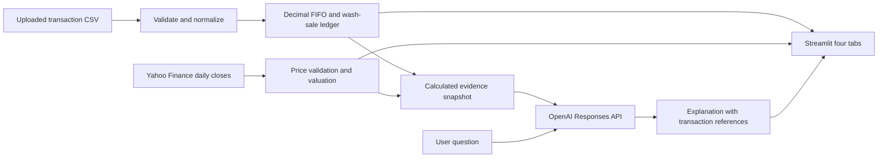

# Portfolio Lens

A local Streamlit stock portfolio analyzer: USD, FIFO, one U.S. taxable
brokerage account, stocks only. Each valid CSV replaces the active session data.

## Run

From `Week1-assignment`:

```sh
uv sync
uv run streamlit run app.py
```

Open the local URL printed by Streamlit. Click **Load sample portfolio**, then
**Fetch / refresh prices** in the sidebar. Prices and AI are requested explicitly;
the transaction analysis works offline.

For AI, set these in the existing local `.env` (never commit it):

```dotenv
OPENAI_API_KEY=your-key
OPENAI_MODEL=gpt-4.1-mini
```

The model is editable in the AI tab to accommodate your account's model access.
Enable portfolio sharing before asking a question. No API call is made just by
opening the app. API responses use `store=False`; this does not override the
provider's other data-handling policies.

## High-level system design



The ledger is the source of financial calculations. OpenAI explains supplied
results rather than performing accounting. Version one sends an explicit snapshot
of transactions, holdings, sale-lot details, wash matches and valuations; it does
not use an autonomous tool-selection loop. Conversation follow-ups include a
bounded recent history and a fresh evidence snapshot.

Portfolio data lives in Streamlit session memory, not a database. Refreshing or
ending the session can require reimporting. Only market prices are cached globally
(15-minute TTL); uploaded portfolio records are not globally cached. Yahoo receives
tickers/date ranges; OpenAI receives portfolio evidence only on an opted-in question.
Importing a different dataset clears prices and the chat.

## Low-level code structure

| File | Responsibility |
|---|---|
| `app.py` | Four tabs, session state, upload controls, date filters, charts and chat |
| `src/week1_assignment/ledger.py` | Typed trades, CSV validation, Decimal calculations, FIFO lot splitting and wash-sale basis propagation |
| `src/week1_assignment/market.py` | Yahoo histories, currency/split checks, latest daily-close valuation and daily holdings-value series |
| `src/week1_assignment/assistant.py` | Evidence serialization, grounding instructions, IRS reference and Responses API call |
| `tests/` | Known accounting examples, sample reconciliation, missing-data handling, mocked AI request and Streamlit smoke test |
| `pyproject.toml`, `uv.lock` | Dependencies and reproducible environment |

CSV row numbers serve as transaction IDs. Dates sort chronologically, with CSV
order breaking ties. Duplicate rows are warned about and retained because identical
trades can be legitimate. Overselling, invalid dates, invalid types, nonfinite
numbers and nonpositive prices/quantities reject the import.

Each purchase begins a lot. A sale consumes the oldest available lots. The engine
maintains original economic cost separately from adjusted tax cost. For a loss on
adjusted cost, it matches eligible replacement shares in purchase order within
the inclusive ±30-day window. Prior replacements must remain held after the sale;
future replacement lots are reserved before their transaction date. Partial
matches split lots. Adjusted per-share costs flow into later sales, allowing
chained wash sales. A replacement share cannot match two losses.

Displayed totals are floats for tables/charts; internal lot arithmetic uses
Decimal without intermediate cent rounding. Tax outputs are estimates, not
Form 8949 records. Holding-period carryover and long/short-term classifications
are not implemented.

## Views and limitations

- Overview: quantity, original and adjusted basis, quote date, market value,
  allocation, unrealized gain and economic realized/combined gain.
- History: date-filtered purchases/proceeds, monthly summaries, sale details,
  holdings value over time and wash-sale review. FIFO uses full history even when
  viewing a shorter period. Replacement trades outside the selected display
  period still participate in matching.
- Wash-sale coverage: the user confirms account history complete through a date.
  A loss sale's forward window is provisional until that date covers sale +30
  days. Covered means within the uploaded account, not complete tax coverage.
- AI: financial claims should refer to provided results and transaction IDs.
  Model mistakes remain possible; the evidence inspector allows verification.
  Hypothetical trade simulation is not implemented and is identified as unavailable.
- No cash, fees, dividends, account-level percentage return, spouse/other-account
  transactions, IRA matching, options, shorts or cross-ticker substantially
  identical security analysis. History must begin before the first purchase;
  imported prior wash adjustments are not supported.
- Yahoo daily closes can be delayed or missing. Currency must be USD. Detected
  stock splits block the ticker's valuation pending reconciliation; other corporate
  actions and delisted symbols may also require manual reconciliation. No prices
  are fabricated and incomplete valuation has no total/allocation.
- Historical valuation uses end-of-day shares and unadjusted daily closes, carrying
  the previous close on market holidays. It is not a total-return or cash chart.

References: [IRS Publication 550](https://www.irs.gov/publications/p550),
[OpenAI Responses API](https://developers.openai.com/api/reference/python/resources/responses/methods/create),
[yfinance history](https://ranaroussi.github.io/yfinance/reference/api/yfinance.Ticker.history.html).

## Verification

```sh
uv run python -m unittest discover -s tests -v
```

Tests avoid live service calls and API charges. Market/network failures surface
in the sidebar; AI failures produce an error rather than a fabricated answer.
